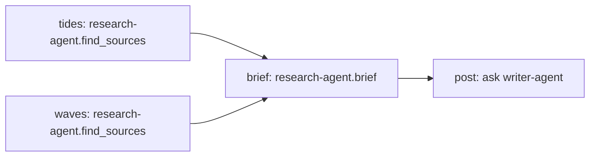

# Model-planned orchestration

**Status: planned (M10), not implemented.** Nothing on this page exists in
`agentframe` yet. The design choices listed under
[decisions confirmed 2026-11-13](#decisions-confirmed-2026-11-13) are decided;
exact signatures and remaining details are settled while building the stories
of the [M10 overview](https://github.com/malcmiller/agentframe/issues/177).

Since M8+, an orchestrator is an ordinary agent whose skill calls specialists it
declared as `Remote[Literal["name"]]` parameters, using plain `await` and
`asyncio.TaskGroup` ([discovery](discovery.md#agent-injection-and-separate-invocation)).
The author decides in code which agent and skill run, in what order. That is
the right default, but it means a model cannot decide which agent to use, and
an agent found with `directory.find(...)` cannot be called at all.

This design lets an orchestrator:

1. build a **catalog of callable remote skills** from its agents' Agent Cards
   (skills, argument schemas from AgentFrame's skill-call extension, free-text
   `ask` for other A2A agents, descriptions and tags), and
2. let its **model choose**: one call at a time through the existing tool loop,
   or a whole **execution plan** (which agents and skills, in what order, in
   parallel where possible, with results flowing between steps) that AgentFrame
   checks and runs with its existing guarantees.

## Goals

- **Owned, small API.** Catalog, plan and run in the same style as the rest of
  AgentFrame: typed values, one `RunContext` method per action, plain Python
  around it. Not a wrapper around LangGraph, Semantic Kernel/Microsoft Agent
  Framework, AutoGen or CrewAI
  ([dependency boundaries](../roadmap.md#independence-and-dependency-boundaries)).
- **Cards are the source.** The catalog comes from native A2A 1.0 Agent Cards,
  so AgentFrame and non-AgentFrame agents (including Foundry agents) both work.
- **Reuse every guarantee.** Remote steps go through the existing `Remote`
  binding: deadline, hop depth, outbound identity, trace/correlation, token
  holds and usage reconciliation stay exactly as in M8+. Nothing a plan does can
  exceed a host ceiling.
- **Control flow is checked before it runs.** A plan is a typed value that is
  validated against the catalog, limits and policy before anything is sent.
- **Opt-in and incremental.** Plain `await` stays the default. Each story is
  usable on its own; the first usable step is remote skills as model tools.

## Non-goals

- A workflow or graph engine: no loops, conditionals, author-facing graph DSL,
  durable or checkpointed plans, pause/resume or crash recovery. Durable
  workflows stay a [revisit after real usage](../roadmap.md#reviewed-release-decisions)
  in a separate optional package (candidate `agentframe-workflows`).
- Automatic replanning, automatic retries of remote steps or built-in human
  approval.
- New A2A wire fields. Plans run as ordinary `call`/`ask` requests.
- Tool retrieval or ranking over large catalogs (hundreds of agents). A
  catalog holds at most 20 entries; larger registries are narrowed explicitly
  ([catalog size](#catalog-size)).
- MCP tool catalogs. MCP stays an optional adapter
  ([#18](https://github.com/malcmiller/agentframe/issues/18)).

## Revisiting the M8+ scope cuts

The [M8+ overview (#17)](https://github.com/malcmiller/agentframe/issues/17)
listed as out of scope "orchestration helpers (plain `await` and
`asyncio.TaskGroup` only)" and "dynamic invocation of agents found at run
time"; #85 (decision 2) deferred calling found agents "to a later story driven
by real usage"; #87 refused `Remote` parameters on `@tool` functions; and the
roadmap says orchestrators are "not a workflow/graph engine", with helpers
"later only after repeated usage". Those were first-release cuts, not
permanent rules.

M10 deliberately revisits two of them, as opt-in features:

| M8+ cut | M10 proposal | Why now |
| --- | --- | --- |
| No orchestration helpers | `ctx.remote_skills`, `ctx.generate(tools=[*skills])`, `ctx.plan`, `ctx.run_plan`. Plain `await`/`TaskGroup` remain the default and are still documented first. | The multi-agent example (#97) shows the pattern: every new specialist needs hand-written glue, and the orchestrator cannot let its model choose. |
| No dynamic invocation of found agents | Every agent registered in the directory's sources is eligible: the registry is the allowlist. An agent joins the catalog only if its card is reachable and valid and its security can be satisfied ([#166](https://github.com/malcmiller/agentframe/issues/166), [#175](https://github.com/malcmiller/agentframe/issues/175)). | New specialists join by being registered, without redeploying the orchestrator; the application already curates its sources. |
| `@tool` cannot take `Remote` | Kept. Catalog entries are the supported way to expose remotes to a model. | One path keeps identity and limits in one place. |

Kept unchanged: no durable workflows, pause/resume or built-in approval; no
typed `Remote[ResearchAgent]` proxy; no registration writes or deployment; no
federation. A plan is a value inside one skill run, executed and discarded with
that run. It is not a workflow definition that authors program against.

## What current practice shows

The design borrows ideas, not code or dependencies:

| Source | Shape | What AgentFrame takes from it |
| --- | --- | --- |
| [ReAct (Yao et al., 2022)](https://arxiv.org/abs/2210.03629) | Interleave reasoning and one tool call at a time. | Already AgentFrame's M5 tool loop; remote skills as tools reuse it. Adaptive, but every step re-reads the context and untrusted results steer the next call. |
| [ReWOO (Xu et al., 2023)](https://arxiv.org/abs/2305.18323) | Planner writes all steps with evidence variables (`#E1`), workers fill them, a solver answers. Reports large token savings over ReAct. | Plan once, reference earlier results by name, no model between steps. |
| [Plan-and-Solve (Wang et al., 2023)](https://arxiv.org/abs/2305.04091) | Ask the model to devise a plan before solving. | One planning call before execution. |
| [LLMCompiler (Kim et al., 2023)](https://arxiv.org/abs/2312.04511) | Planner emits a DAG of tasks with `$1` placeholders; an executor runs independent tasks in parallel; a joiner may replan. | Flat DAG, placeholder references, parallel execution of ready steps. AgentFrame leaves replanning to the author. |
| [Magentic-One (Fourney et al., 2024)](https://arxiv.org/abs/2411.04468) | An orchestrator keeps a task ledger and progress ledger, delegates to specialist agents and replans when stuck. | Per-step status and usage ("ledger") for observability; replanning only as an explicit author step. |
| [Anthropic, *Building effective agents*](https://www.anthropic.com/engineering/building-effective-agents) | Distinguishes workflows (predefined paths) from agents; recommends the simplest pattern that works; "orchestrator-workers" for unpredictable subtasks. | Keep plain code as the default; offer orchestrator-workers as an opt-in. |
| [A2A agent discovery](https://a2a-protocol.org/latest/topics/agent-discovery/) | Well-known cards, curated registries, direct configuration; selection by skills, interfaces and security. | Catalog from cards in AgentFrame's existing curated directory; security requirements decide eligibility. |
| [OpenAI function calling](https://platform.openai.com/docs/guides/function-calling) | Advises fewer than 20 functions at a time for accuracy; tool schemas count as input tokens. | At most 20 catalog entries, bounded descriptions and schemas. |
| [RAG-MCP (Gan & Sun, 2025)](https://arxiv.org/abs/2505.03275) | Selection accuracy drops sharply as tool count grows ("prompt bloat"); retrieves a few tools first. | Keep catalogs small and narrowable (`agents=`, `skill=`, `tags=`); retrieval is out of scope. |
| [MCP tools specification](https://modelcontextprotocol.io/specification/2025-06-18/server/tools) | Tool descriptions and annotations are untrusted unless from a trusted server; hosts should confirm sensitive calls. | Card text is untrusted data; permissions and checks before calls. |

Security research shapes the boundaries:

- [Beurer-Kellner et al., *Design Patterns for Securing LLM Agents against
  Prompt Injections* (2025)](https://arxiv.org/abs/2506.08837) describe
  **plan-then-execute**: fix the actions before the agent reads untrusted
  content, so injected text can change data but not which actions run.
  [CaMeL (Debenedetti et al., 2025)](https://arxiv.org/abs/2503.18813) goes
  further, separating control flow from data flow with capabilities on values.
  AgentFrame plans follow the first pattern: no model reads step results
  between steps, and references copy values without interpreting them.
- [Tool poisoning](https://invariantlabs.ai/blog/mcp-security-notification-tool-poisoning-attacks)
  hides instructions in tool descriptions. Agent Card descriptions are the same
  risk, so card text is bounded and passed as data, never as instructions.
- [The lethal trifecta](https://simonwillison.net/2025/Jun/16/the-lethal-trifecta/)
  (private data, untrusted content, a way to send data out) applies to any plan
  that moves results from one agent to another. Plan checks can inspect every
  data reference before execution.
- OWASP's [LLM06 Excessive Agency](https://genai.owasp.org/llmrisk/llm062025-excessive-agency/)
  and [LLM10 Unbounded Consumption](https://genai.owasp.org/llmrisk/llm102025-unbounded-consumption/)
  motivate narrow catalogs, per-call permissions and hard step, parallelism and
  token limits. With service identity, a model choosing calls is a classic
  confused deputy: the orchestrator's authority used on a caller's behalf.

## API sketch

Illustrative until built. Public names are importable from `agentframe`.

```python
# proposed, not implemented
from typing import Literal

from agentframe import Agent, Remote, RunContext, agent, skill

type Research = Remote[Literal["research-agent"]]
type Writer = Remote[Literal["writer-agent"]]


@agent(name="Orchestrator", version="0.1.0")
class Orchestrator(Agent):
    """Answers goals by delegating to specialist agents."""

    @skill(id="answer", tags=["orchestration"])
    async def answer(self, goal: str, ctx: RunContext) -> str:
        """Let the model call any registered specialist, one at a time."""
        skills = await ctx.remote_skills(tags=["research"])  # whole directory, narrowed
        return await ctx.generate(goal, tools=[*skills])

    @skill(id="report", tags=["orchestration"])
    async def report(
        self, goal: str, research: Research, writer: Writer, ctx: RunContext
    ) -> str:
        """Plan the whole job first, then run it with parallel steps."""
        skills = await ctx.remote_skills(research, writer)  # only these two
        plan = await ctx.plan(goal, skills, max_steps=6)
        result = await ctx.run_plan(plan, skills, max_parallel=4)
        return str(result.value)
```

A plan the model might produce for "write a post about tides and waves":

```json
{
  "steps": [
    {"id": "tides", "use": "research-agent.find_sources", "arguments": {"topic": "tides"}},
    {"id": "waves", "use": "research-agent.find_sources", "arguments": {"topic": "waves"}},
    {"id": "brief", "use": "research-agent.brief",
     "arguments": {"sources": {"$ref": "tides"}, "more_sources": {"$ref": "waves"}}},
    {"id": "post", "use": "writer-agent", "text": "Write a short post from this brief: {brief}"}
  ],
  "result": "post"
}
```

`tides` and `waves` run in parallel, `brief` waits for both, and `post` asks the
writer in free text with the brief inserted.



## Remote skill catalog

`await ctx.remote_skills(*remotes, agents=None, skill=None, tags=(), ask=False,
permissions=None, max_tokens_per_call=None)` returns a `SkillCatalog`
([#166](https://github.com/malcmiller/agentframe/issues/166)): an immutable list
of `RemoteSkill` entries plus the run's bindings.

| `RemoteSkill` field | Meaning |
| --- | --- |
| `name` | `"agent.skill"` for a structured skill, `"agent"` for a free-text `ask` entry. Used in plans, logs and policy checks. |
| `agent` | The directory name. |
| `skill` | The card skill ID, or `None` for `ask`. |
| `description`, `tags` | From the card, bounded (see below). |
| `arguments_schema` | The JSON Schema from the card's skill-call extension (`params.skills[id]`), or `None` for `ask`. |
| `requires_permissions` | Permissions the caller must hold; empty unless the author sets `permissions=` ([#168](https://github.com/malcmiller/agentframe/issues/168)). |

An agent whose card declares AgentFrame's skill-call extension contributes one
entry per card skill. An agent without it (any non-AgentFrame agent) contributes
one `ask` entry describing the agent; its card skills are descriptive only,
because base A2A has no standard way to select a skill. `ask=True` adds `ask`
entries for extension agents too. Cards carry argument schemas but not result
schemas, so results are untyped JSON or text until the author validates them.

The name "capability" is avoided because A2A already uses `AgentCapabilities`
for streaming and extensions on the card.

### Eligible agents

The registry is the allowlist. With no positional `remotes`, the catalog
considers **every agent registered in the directory's sources** (decision 2).
The application already curates those sources (YAML file, environment,
Foundry project, custom registry), so registering an agent is what makes it
available to orchestrators; there is no second allowlist. An agent and its
skills become options for the model only when:

1. its card is reachable and valid under the existing directory checks (#84:
   https or an allowed HTTP host, same-origin interface URL, no redirects,
   size and time bounds, cache and stale rules), and
2. AgentFrame can satisfy its card's security with the agent's
   [identity](#identity) (the same check `remotes=` entries get at startup).

Every other agent is **skipped, not fatal**: the catalog logs one WARNING per
skipped agent with only its name and the reason class (`card unavailable`,
`card invalid`, `security not satisfied`, `schema too large`), never card
content or URLs. A source that fails to list is skipped with a warning naming
only its position and class (for example `source 2 (FoundryAgentRegistry)`),
and the agents of the other sources are still used. An empty catalog is valid;
`ctx.plan` with it raises `InputValidationError`. Configuration mistakes
(no directory, duplicate names across sources, an unknown name in `agents=`)
still raise `DefinitionError`.

Passing declared `Remote` parameters (`ctx.remote_skills(research, writer)`)
restricts the catalog to exactly those agents. They were validated at startup,
so a failure there raises as in M8+ instead of being skipped: the author named
them explicitly.

### Catalog size

A registry can list more than the 20 entries a model chooses among reliably.
The catalog **never truncates silently**. Authors narrow it with `agents=`
(names), `skill=` and `tags=` (the same same-skill, all-of matching as
`directory.find`, #85) or declared remotes. If more than 20 entries remain
after narrowing and skipping, `remote_skills` raises `DefinitionError` with the
count and the narrowing options, before any model call. Failing is the simplest
safe choice: dropping entries would make the model's options depend on
registry order, and a growing registry shows up as a clear error instead of
quietly different behavior.

### Identity

Each agent's credentials are chosen in order (decision 3):

1. its own per-name `remotes=` entry (`Service(credential=...)` or
   `OnBehalfOf(scope=...)`);
2. otherwise the application's optional default,
   `AgentApp(default_remote=Service(...) | OnBehalfOf(...))`
   ([#175](https://github.com/malcmiller/agentframe/issues/175)), used only for
   agents whose card security it satisfies;
3. otherwise no credentials, which works only for open cards.

An agent whose security none of these satisfies is skipped. Without a default,
only open agents and agents with `remotes=` entries are included. Credentials
still go only to the card's validated interface origin, never across
redirects.

The default credential is sent to every registered agent whose card asks for
its scheme. With an Entra default, each of them receives a token for the
default's audience and could replay it there; with an `APIKeyCredential`
default, each receives the same key and could use it against any other agent
that accepts it. Configure a default only when every registered agent is
trusted with that token audience or key; give other agents their own
`remotes=` entries. An `OnBehalfOf` default on a host without `EntraIDAuth`
(with a client credential) fails startup with `DefinitionError`, as for
`remotes=` entries (#93).

The orchestrator never appears in its own catalog: an agent whose validated
interface URL equals the host's advertised URL (`HostConfig`) is left out
without a warning. A local `Runtime` has no advertised URL, so nothing is
excluded there; a registry that lists the orchestrator under another URL is
still bounded by `max_remote_hops`.

### Untrusted card text

Card names, descriptions, tags and schemas come from other parties. The catalog:

- cuts descriptions to 500 characters, keeps at most 10 tags, removes control
  characters and does not copy card `examples`; `description` strings inside
  argument schemas are cut to 500 characters too;
- holds at most 20 entries ([catalog size](#catalog-size)) and skips, with a
  warning, an agent whose schema is over 8 KiB, keeping tool-selection accuracy
  and prompt cost bounded;
- never appears in trusted system instructions: for plans it is quoted data in
  the user message; for remote skills as tools it becomes the tool
  definitions.

Worst case, 20 entries with 8 KiB schemas add about 160 KiB of catalog text to
every model call of the run (each tool-loop turn, or the one planning call).
It counts toward `max_input_tokens` and the token budget like any input, so
narrow the catalog for cost as well as accuracy.

Bounding text reduces, but cannot remove, injection through descriptions; the
catalog's real protection is that the model can only choose among agents the
application registered, narrowed by the author, and only with the permissions
and checks below.

## Remote skills as model tools

The first usable step ([#167](https://github.com/malcmiller/agentframe/issues/167)):
`ctx.generate(goal, tools=[*skills])` offers catalog entries next to ordinary
`@tool` functions. Each entry becomes one model tool with a provider-safe name,
its bounded description and its argument schema (`{"text": string}` for `ask`).

- A tool call runs `Remote.call` or `Remote.ask` on the catalog's per-run binding (declared remote or registry agent), so deadline,
  depth, identity, correlation and token reconciliation are unchanged. Calls
  stay sequential as in M5, each counts toward `max_tool_calls`, and none is
  retried automatically: remote side effects are unknown.
- Each call holds `max_tokens_per_call=` tokens when the author set it on the
  catalog, otherwise everything the run has left, which is safe because calls
  are sequential.
- Results return to the model as untrusted tool output. A `RemoteAgentError` or
  `ClarificationNeededError` becomes a safe tool error naming only the class, so
  the model can try something else; limits, authorization and policy fail the run.

This is ReAct over remote agents: adaptive, but every result is read by the
model before it chooses the next call, so injected content in one agent's
answer can steer later calls. Use plans when the job can be laid out up front.

## Plans

### Plan shape

A plan is a frozen Pydantic value
([#169](https://github.com/malcmiller/agentframe/issues/169)):

| Field | Meaning |
| --- | --- |
| `Plan.steps` | Steps in any order; execution order comes from dependencies. |
| `Plan.result` | The step whose value is the plan's value. |
| `PlanStep.id` | `^[a-z][a-z0-9_]{0,31}$`, unique. |
| `PlanStep.use` | A catalog entry name. |
| `PlanStep.arguments` | JSON arguments for a structured entry, possibly with references. |
| `PlanStep.text` | The message for an `ask` entry, possibly with placeholders. |
| `PlanStep.after` | Extra ordering without data, for example "notify after saving". |

A plan is a directed acyclic graph: no loops, conditionals or nested plans.
That is the smallest shape a model emits reliably and a person can review at a
glance. `Plan` is public so tests and reviewed plans can construct one, but
there is no builder DSL.

### Data between steps

- In `arguments`, a value `{"$ref": "brief"}` is replaced by that step's whole
  result and `{"$ref": "brief.summary"}` by one top-level field of it. Types are
  preserved.
- In `ask` text, `{brief}` or `{brief.summary}` is replaced by the value as
  text (JSON for non-strings); `{{` and `}}` are literal braces.
- No expressions, indexing, filters or functions. References copy values; no
  model reads them between steps.

### Validation before execution

`SkillCatalog.check(plan, max_steps=8)` runs without I/O, and `ctx.run_plan`
runs it again:

- step IDs unique and well formed; every `use` in the catalog; `arguments` only
  on structured entries and `text` only on `ask` entries;
- every reference and `after` names an existing step; no cycles; `result` exists;
- at most `max_steps` steps (default 8, never above the run's remaining
  `max_tool_calls`) and at most 64 KiB serialized;
- literal arguments checked against the card schema's top level only: required
  properties present (or referenced) and no unknown properties when the schema
  forbids them. The receiving agent validates fully, as it already does.

Failures raise `InputValidationError` naming the step and field, never values.

### Planning call

`await ctx.plan(goal, skills, max_steps=8, instructions=None)`
([#170](https://github.com/malcmiller/agentframe/issues/170)) makes one
structured-output call with the agent's model, charged to the run's model calls
and tokens, with `model_request_checks` applied:

- Library-owned planning instructions (plus optional trusted author
  `instructions=`) are system messages. The goal and the catalog go in the user
  message as quoted data.
- The model-facing schema lists entry names as an enum and carries each step's
  arguments as a JSON string, so it converts for Foundry strict mode and Ollama
  `format`, the same technique as M6 routing. The reply is parsed, then checked.
- The model may decline with a reason; `ctx.plan` then raises
  `InputValidationError("No plan for this goal with the available skills")`
  without the model's text. An invalid plan raises `OutputValidationError` and
  is never repaired or re-requested, like `output=`.

## Running a plan

`await ctx.run_plan(plan, skills, max_parallel=4, max_tokens_per_step=None,
on_failure="stop")` ([#171](https://github.com/malcmiller/agentframe/issues/171))
checks the plan, then runs it under one `asyncio.TaskGroup`: a step starts when
its dependencies have completed, with at most `max_parallel` at once. References
are resolved just before a step starts and the top-level argument check runs
again. It returns a `PlanResult`:

| Field | Meaning |
| --- | --- |
| `value` | The `result` step's value, or `None` when it did not complete. |
| `complete` | Whether every step completed. |
| `steps` | Per step: `status` (`completed`, `failed`, `skipped`, `cancelled`, `input_required`), `value`, `error` (class and safe message), `usage` (`Usage \| None`), `remote_task_id`, `duration`. |
| `usage` | The plan's total; unknown if any step's usage is unknown. |

### Budgets, deadlines and depth

- The whole plan runs within the run's deadline; each step sends the remaining
  time, as every remote call does (#89).
- Each step is one call at the next hop; `max_remote_hops` is unchanged.
- Each step counts as one tool call toward `max_tool_calls`, an existing host
  ceiling for model-chosen actions.
- Token holds: `max_tokens_per_step` when given, otherwise the run's remaining
  tokens at start divided by the number of steps. Parallel steps need separate
  holds (#90), and budgets come from trusted code, never from the model. The
  peer's reported usage replaces each hold; a peer that does not report makes
  usage unknown, never zero.

### Failures and partial results

- `on_failure="stop"` (default): the first failure cancels running steps, which
  sends best-effort `CancelTask` through the existing binding, and raises the
  original error, never an `ExceptionGroup`.
- `on_failure="continue"` ([#172](https://github.com/malcmiller/agentframe/issues/172)):
  dependents of a failed step are `skipped` and never sent, independent steps
  still run, and the partial `PlanResult` is returned. A remote question marks
  its step `input_required`; nothing answers it automatically.
- Limits, authorization, policy and cancellation always stop the plan,
  whatever `on_failure` says.
- No step is retried automatically. Cards do not say whether a skill has side
  effects, so every remote step is treated as one.

### Replanning

Not built in. Automatic replanning, as in LLMCompiler's joiner or Magentic-One's
outer loop, feeds step results back into the planner and so lets untrusted
content change which actions run next. An author who wants it calls `ctx.plan`
again with an explicit, reviewed summary of what happened; the extra call is
bounded by `max_model_calls` like any other.

## Observability

([#173](https://github.com/malcmiller/agentframe/issues/173))

- `Plan created` (step count and entry names), `Plan step started` and
  `Plan step completed` INFO records with `extra`: `agent`, `invocation_id`,
  `root_invocation_id`, `plan_step`, `use`, `status`, `remote_task_id`,
  `duration_ms`, `total_tokens` (or `None`). No arguments, text or results.
- Peers see the orchestrator invocation as their parent and the same root
  ([tracing](tracing.md)); the remote task ID ties a step to the peer's logs, so
  no new wire field is needed.
- `RunResult.usage` already includes every step; `PlanResult` breaks it down.

## Safety

### Authorization and approval

- **Per-entry permissions** ([#168](https://github.com/malcmiller/agentframe/issues/168)):
  `remote_skills(..., permissions={"billing-agent.refund": {"refunds:write"}})`.
  Entries the caller lacks are hidden from the model and refused if named.
- **Per-call checks:** before every remote call, for tools and for every plan
  step, the entry's permissions are re-checked and the existing
  `ExecutionPolicy.tool_checks` run with `tool_name` set to the entry name and
  the arguments about to be sent: for plan steps, after `$ref` and placeholder
  substitution. This is the data-exfiltration gate: a check sees exactly which
  data goes to which agent.
- **Plan checks** ([#174](https://github.com/malcmiller/agentframe/issues/174)):
  new `ExecutionPolicy.plan_checks`, async `(skill, principal, plan) -> bool`,
  run before the first step with the usual fail-closed rules. They see every
  step and reference, so they can refuse plans that move internal results to an
  external agent.
- **Human approval stays application-owned.** The documented pattern is two
  skills: one returns `ctx.plan(...)`, another accepts a `Plan` argument and
  calls `ctx.run_plan`. A caller-supplied plan is untrusted input and is checked
  against the catalog and the caller's permissions again. There is no built-in
  pause/resume.
- **The execute skill can become an open proxy.** It runs caller-supplied plans
  with the orchestrator's outbound identity, so with `Service` identity any
  caller who reaches it can call any catalog entry as the orchestrator. Give
  the execute skill `requires_permissions`, run it over a narrowed catalog
  (`agents=`, `skill=`, `tags=` or declared remotes), and prefer `OnBehalfOf`
  so each agent sees the real user.
- **Remote agents still decide.** Each agent authenticates and authorizes the
  request itself. With `OnBehalfOf` it sees the user; with `Service` it sees the
  orchestrator, which is why consequential entries need `permissions=`.

### Prompt injection and data flow

- The model chooses only among catalog entries; plan validation enforces that.
- Card text never appears in trusted system instructions: for plans it is
  data in the user message, for tool calls it becomes tool definitions. The
  goal is always user-message data.
- In plans, no model reads results between steps, so injected content in one
  agent's answer can change the data a later step receives but not which steps
  run (plan-then-execute). Remote skills as tools do not have this property.
- Data moving between agents is explicit in the plan and visible to plan checks.
  There is no taint or label system yet; CaMeL-style capabilities are a larger
  design to revisit with real usage.
- Fan-out and cost are bounded by `max_steps`, `max_parallel`,
  `max_tool_calls`, per-step token holds, the run's token budget and deadline,
  and each peer's own admission limits.

## Evaluation (M9)

[M9](evaluation.md) evaluates whole skills, so an orchestrator is already an
evaluation target. Plan quality (did the model choose the right agents and
skills) is a narrower question: M9 excludes trajectory scoring because there is
no trajectory contract. `PlanResult` and the returned `Plan` provide one for
orchestrators: a scorer can compare the entries used against a case's expected
entries. The acceptance story
([#176](https://github.com/malcmiller/agentframe/issues/176)) runs a small planner
evaluation with M9's harness, so only that story depends on M9 (#153, #156).

## Packaging

No new dependency: plans use Pydantic, the existing A2A client and
`asyncio.TaskGroup`. The code lives in `src/agentframe/orchestration/` in the
main wheel, with public names exported from `agentframe` because they appear on
`RunContext`. No extra.

## Decisions confirmed 2026-11-13

The maintainer confirmed these on 2026-11-13: questions 1-5 one at a time
(decision 2 is the maintainer's own answer, and decision 3 was reframed to fit
it), and the recommendations for the rest. Story-level details are recorded in
each story of the [M10 overview](https://github.com/malcmiller/agentframe/issues/177).

1. **Revisit #17's cuts.** **Decision:** lift "orchestration helpers" and
   "dynamic invocation" as opt-in features and keep every other cut; plain
   `await` stays the default.
2. **Eligible agents.** **Decision:** every agent registered in the
   directory's sources is eligible; the registry is the allowlist. An agent is
   added only if its card is reachable and valid under the #84 checks and its
   security can be satisfied; otherwise it is skipped with a warning by name.
   No separate application allowlist.
3. **Identity.** **Decision:** the agent's own `remotes=` entry; otherwise an
   optional application default (`default_remote=`) used only where it
   satisfies the card; open agents need none; anything else is skipped.
4. **First step.** **Decision:** ship remote skills as model tools (#167,
   #168) before plans.
5. **Styles.** **Decision:** both: the tool loop for adaptive work, plans for
   parallel or cost-controlled work.
6. **Graph representation.** **Decision:** flat list of steps, dependencies
   from references plus `after`, DAG only, public `Plan` but no builder DSL.
7. **Plan limits.** **Decision:** 8 steps by default (never above remaining
   `max_tool_calls`), 64 KiB, `max_parallel=4`, each step one tool call.
8. **Data passing.** **Decision:** `{"$ref": "step.field"}` in arguments,
   `{step.field}` in `ask` text, copied values, no expressions.
9. **Argument checking.** **Decision:** local top-level required/unknown
   checks, full validation by the receiver; no JSON Schema validator dependency.
10. **Per-step token budget.** **Decision:** author-set `max_tokens_per_step`,
    default an equal share of the remaining budget.
11. **Failure policy.** **Decision:** `stop` by default, opt-in `continue` with
    partial results; limits, authorization, policy and cancellation always
    stop; no retries.
12. **Replanning.** **Decision:** none built in; authors may call `ctx.plan`
    again explicitly.
13. **Approval hook.** **Decision:** `ExecutionPolicy.plan_checks` plus the
    documented propose/execute two-skill pattern; no pause/resume.
14. **Authorization of model-chosen calls.** **Decision:** per-entry
    `permissions=` plus existing `tool_checks` with the entry name; entries the
    caller lacks are hidden.
15. **Untrusted card text.** **Decision:** 500-character descriptions, 10 tags,
    no examples, at most 20 entries (over the cap fails with `DefinitionError`
    after narrowing, never truncated), 8 KiB per schema (larger skipped), card
    text never in trusted system instructions (user-message data for plans,
    tool definitions for tool calls).
16. **Planning errors.** **Decision:** reuse `InputValidationError` and
    `OutputValidationError`, no repair.
17. **Package placement.** **Decision:** main wheel, public names from
    `agentframe`, code in `src/agentframe/orchestration/`, no extra.
18. **Milestone placement.** **Decision:** M10 after the M8+ release, built in
    parallel with M9; only the acceptance story (#176) waits for M9's harness.
